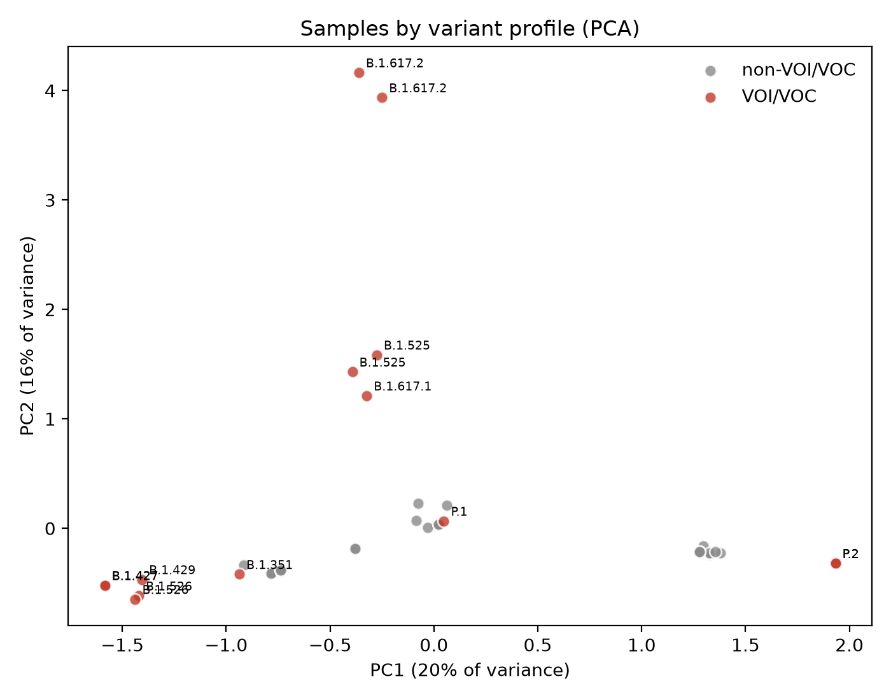
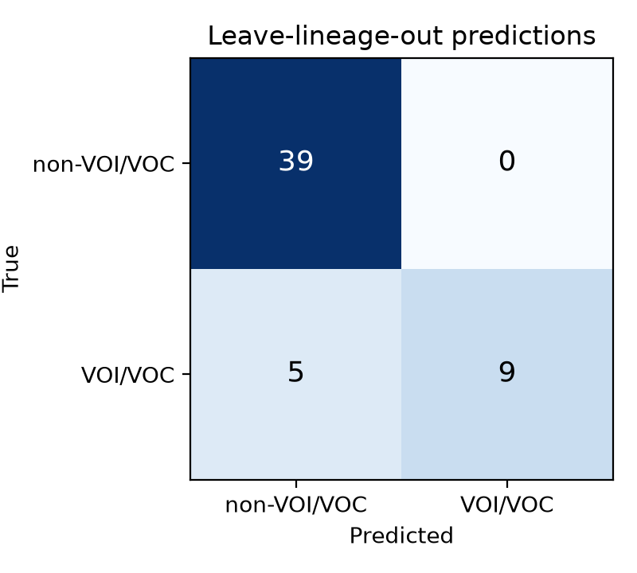
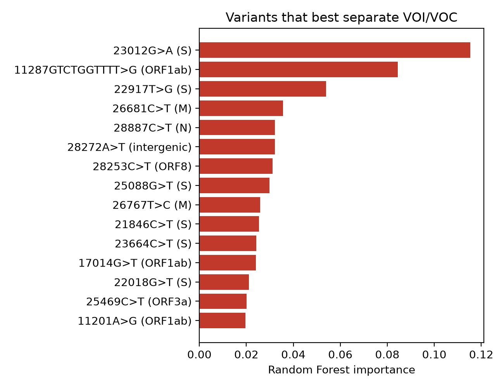

# Reads to lineages: SARS-CoV-2 variant calling, QC and VOI/VOC classification

A short-read pipeline (fastp → BWA-MEM → samtools → bcftools) applied to 79 public SARS-CoV-2 Illumina samples, followed by a scikit-learn analysis asking whether variant profiles can tell Variants of Interest/Concern (VOI/VOC) apart from other lineages.

**Main findings**

- The pipeline recovered all 12 lineage-defining Spike mutations of a Gamma (P.1) validation sample.
- Validating against a known lineage exposed three problems that default settings hide: an indel silently missed at high depth, a low-frequency deletion artefact reported as high-frequency, and mutations missing because of amplicon dropout. 

- Read-level QC (coverage breadth and coverage gaps) caught all contamination and host-contamination failures in the CDC failed-QC set, but not failures caused by low depth, ambiguous bases or frameshifts.
- A Random Forest separates VOI/VOC from other lineages with balanced accuracy **0.93** under standard cross-validation, but **0.82** when tested on lineages it has never seen. The most informative variants are mutations that arose independently in several unrelated VOC lineages (for example Spike E484K and L452R, and the nsp6 deletion).

---

## Question

1. Can variant profiles from short-read alignment distinguish SARS-CoV-2 VOI/VOC samples from other lineages, and which mutations drive the separation?
2. Do standard read-level QC metrics catch samples that are known to have failed QC?

## Data

The CDC SARS-CoV-2 benchmark datasets (Xiaoli et al. 2022, *PeerJ* 10:e13821; [CDCgov/datasets-sars-cov-2](https://github.com/CDCgov/datasets-sars-cov-2)): curated Illumina paired-end amplicon data with known lineages and known failure reasons.

| Dataset | Samples | Role in this project |
|---|---|---|
| VOI/VOC lineages | 16 (10 lineages) | Positive class |
| Non-VOI/VOC lineages | 39 | Negative class |
| Failed QC | 24 (8 failure scenarios) | Test of the QC step |

`scripts/make_samples.py` builds `samples.tsv` from the three CDC sheets (in `metadata/`). Reads were downloaded from SRA/ENA with `fasterq-dump`, using `prefetch` for runs that timed out.

Two runs (ERR5691945, ERR5181310) failed alignment because their read-1 and read-2 files did not match in the archive itself (for ERR5181310, 2,988 reads only in read 1 and 56 only in read 2). Re-downloading produced identical files, so reads were re-paired by name with `seqkit pair`, keeping 99.7% of pairs.

## Pipeline

```
FASTQ ─ fastp ─ BWA-MEM ─ samtools sort/index ─ QC ─ bcftools mpileup/call ─ indel check ─ filter ─ VCF
                                                                                                    │
                                                         build_matrix.py ─ variant matrix ─ analysis.py
```

Reference: Wuhan-Hu-1 (NC_045512.2), the reference used by ARTIC primer coordinates and standard mutation nomenclature.

| Step | Tool | Key settings and why |
|---|---|---|
| Trimming | fastp | Default adapter and quality trimming |
| Alignment | BWA-MEM 0.7.19 | Read group per sample (`-R`) |
| QC | samtools flagstat, coverage, depth | % mapped, % genome covered, mean depth, longest gap (< 10× depth) |
| Variant calling | bcftools mpileup / call | `--ploidy 1` (haploid virus); `-d 10000` and `-L 10000`, because amplicon data has thousands of reads per site and the defaults (250) are set for human genomes |
| Indel check | samtools mpileup + awk | Each indel is re-counted against **all** reads at its site and removed if carried by < 75% of them |
| Filtering | bcftools view | QUAL ≥ 30, DP ≥ 20, allele frequency ≥ 0.75 |

Duplicates were deliberately **not** removed: in amplicon data every read from an amplicon starts at the same primer, so they would all look like PCR duplicates.

## Validation: what a known lineage revealed

The pipeline was first run end to end on one P.1 (Gamma) sample, ERR5556343, and the calls were compared with Gamma's known mutations.

**All 12 lineage-defining Spike mutations were recovered** (L18F, T20N, P26S, D138Y, R190S, K417T, E484K, N501Y, D614G, H655Y, T1027I, V1176F), together with the ancestral B.1 markers (C241T, C3037T, C14408T).

Three things were missing or wrong at first, and each turned into a pipeline fix:

**1. A real deletion was silently missed.** Gamma's 9 bp nsp6 deletion (positions 11288–11296) was not called. `bcftools mpileup` skips indel calling at sites above 250× depth by default (`-L 250`), a setting designed for human genomes at around 30×. Depth here was in the thousands. Setting `-L 10000` recovered the deletion (supported by 3,174 of 3,204 informative reads).

**2. An artefact looked like a high-frequency deletion.** bcftools reported a 12 bp deletion at position 25519 in 87% of reads (123/142). Counting the raw pileup showed only **131 of 10,424 reads (1.3%)** carried it, all on the reverse strand. bcftools computes depth and allele counts for an indel only from the reads it re-aligns around the candidate; near an amplicon boundary that subset was small and unrepresentative. Raising filter thresholds inside bcftools did not remove it, so the pipeline now verifies every indel against all reads at the site (`results/qc/<sample>.indel_af.tsv` logs each decision).

**3. Mutations were missing because there were no reads.** Gamma's ORF8 and N mutations were absent because positions 27,534–29,903 (2,370 bp, covering ORF7, ORF8 and almost all of N) had less than 10× depth: an amplicon dropout. The sample still covers 92% of the genome, so a breadth threshold alone would pass it. This motivated reporting the longest gap per sample and treating low-coverage sites as unknown rather than reference in the variant matrix.

## Quality control

`results/qc/summary.tsv` has one row per sample. Median genome coverage was 99.3% (VOI/VOC), 99.8% (non-VOI/VOC) and 90.9% (failed QC).

Two VOI/VOC samples fell below 90% coverage and were excluded from modelling: ERR5405022 (Alpha, 41%) and ERR5743893 (Kappa, 67%).

**How well does read-level QC catch known failures?** Flagging samples with < 90% genome covered or a gap > 1 kb caught **11 of the 24** CDC failed-QC samples:

| CDC failure reason | Caught? | Why |
|---|---|---|
| High host contamination; contaminated negative controls | Yes, all | Low mapping rate and very low coverage |
| Low coverage breadth | Mostly | Gaps show up directly |
| Low coverage depth | No | "% covered" counts any base with ≥ 1 read, so a thinly covered genome still looks complete |
| Too many ambiguous bases (Ns) | No | Ns arise where depth is too low to call a base confidently, not only where depth is zero |
| Frameshift flagged by VADR | No | A failure of the assembled genome's annotation, not detectable from read metrics |

A natural next step is a depth-aware metric such as "% of genome at ≥ 20×".

## Variant matrix

`scripts/build_matrix.py` combines the 79 filtered VCFs into a samples × variants matrix (442 variants):

| Value | Meaning |
|---|---|
| 1 | Variant called |
| 0 | Not called, and ≥ 20 reads covered the site (confidently reference) |
| NA | Not called, but too few reads to tell |

Recording low-coverage sites as NA, not 0, prevents amplicon dropout (as in the Gamma sample above) from being read as "this sample lacks the mutation".

## Classification: VOI/VOC vs other lineages

`scripts/analysis.py` uses the 53 samples that pass QC (14 VOI/VOC from 9 lineages, 39 non-VOI/VOC) and the 92 variants seen in at least 2 of them. 334 of the 442 variants occur in a single sample and cannot generalise.

### Without labels, the groups do not separate

K-means with two clusters does not recover the VOI/VOC grouping (adjusted Rand index −0.05). PCA groups samples by lineage family instead. That is expected: "VOI/VOC" is a public-health designation given to lineages from different branches of the tree, not one branch.



### With labels, the honest evaluation matters

| Evaluation | Balanced accuracy | VOI/VOC recall |
|---|---|---|
| Baseline (random guess in class proportions) | 0.60 | — |
| Random Forest, stratified 5-fold CV × 10 | 0.93 ± 0.11 | 0.86 |
| Random Forest, **leave-lineage-out** | **0.82** | **0.64** |

Standard cross-validation lets samples of the same lineage appear in both training and test folds, so the model can recognise a lineage from its sibling. Leave-lineage-out (`StratifiedGroupKFold` grouped by lineage) asks the surveillance question: would the model flag a lineage it has never seen? Under that test it misses 5 of 14 VOI/VOC samples: Delta, Kappa, both P.2 samples and B.1.526.



### What the model relies on



The top variants include Spike **E484K** (23012G>A; in 50% of VOI/VOC samples and none of the others), the **nsp6 deletion** (11287; 43% vs 0%) and Spike **L452R** (22917T>G; 36% vs 0%). These mutations arose independently in several unrelated VOC lineages, so the model has largely learned a signature of convergent evolution rather than any single lineage. *[Protein names for the remaining variants in `feature_importance.tsv` to be confirmed with Nextclade.]*

The signal is concentrated: removing the 10 most important variants drops leave-lineage-out VOI/VOC recall from 0.64 to 0.36.


## Limitations

- **Small positive class.** 14 VOI/VOC samples from 9 lineages; results will vary with more data.
- **Feature filtering before cross-validation.** The "seen in ≥ 2 samples" filter was applied to all 53 samples before splitting; a stricter design would apply it inside each fold.
- **Importance is descriptive.** Feature importance comes from a model fitted to all samples and describes this dataset.
- **Imputation.** Missing sites are filled as reference (0) inside each training fold. This matters little for the included samples (2.2% missing) but dominates for low-coverage samples.


## Reproducing the analysis

```bash
conda create -n varcall -c conda-forge -c bioconda bwa samtools bcftools fastp sra-tools seqkit multiqc python=3.11 pandas scikit-learn matplotlib seaborn
conda activate varcall

python scripts/make_samples.py metadata/sars-cov-2-voivoc.tsv metadata/sars-cov-2-nonvoivoc.tsv metadata/sars-cov-2-failedQC.tsv
# download reads into data/raw/ with fasterq-dump (see Data)
bwa index data/ref/NC_045512.2.fasta && samtools faidx data/ref/NC_045512.2.fasta
bash scripts/run_pipeline.sh          # per sample: trim, align, QC, call, filter; safe to re-run
python scripts/build_matrix.py        # variant matrix
python scripts/analysis.py            # PCA, clustering, classification, figures
```

Tool versions: BWA 0.7.19; *[add fastp, samtools, bcftools and scikit-learn versions, e.g. from `conda env export --from-history > environment.yml`]*.

## Repository structure

```
scripts/
  make_samples.py      build samples.tsv from the CDC sheets
  run_pipeline.sh      reads to filtered VCF, plus per-sample QC
  build_matrix.py      VCFs to samples × variants matrix (1 / 0 / NA)
  analysis.py          PCA, K-means, Random Forest, figures
metadata/              CDC benchmark sheets
samples.tsv            accession, group, lineage, CDC note
results/
  qc/                  summary.tsv and per-sample QC logs
  vcf/                 raw and filtered VCFs
  matrix/              variant matrix, sample metadata, variant summary
  analysis/            results.txt, figures, feature importance, predictions
data/                  reads, BAMs, reference (not tracked)
```

## Acknowledgements

Data: Xiaoli L, et al. (2022). Benchmark datasets for SARS-CoV-2 surveillance bioinformatics. *PeerJ* 10:e13821.

Author: Amy Stubbs
